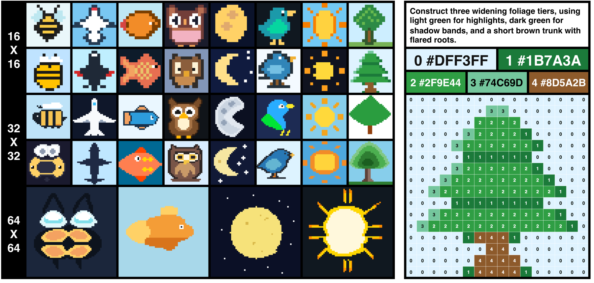

# PixelBench

**Can LLMs Understand and Generate Images Pixel by Pixel?**

Haoquan Zhang · Feiyang Liu · Juanxi Tian · Wanhua Li · Haodong Duan · Weiyang Liu



PixelBench evaluates image generation and understanding through ordinary text tokens.
A model produces a small RGB palette and a grid of palette indices; rendering is a
deterministic lookup. Pixel Reconstruction Tuning (PRT) uses this representation as
visual supervision for Molmo2 and Qwen3-VL.

| Task | Input | Evaluation set | Main metrics |
| --- | --- | --- | --- |
| Text-to-pixel | Object label | 100 concepts × 3 resolutions | 500-way SigLIP Top-1, VLM judge |
| Image-to-pixel | Reference image | 100 ImageNet crops × 3 resolutions | 100-way Top-1, SigLIP cosine, DINOv2 cosine |
| Pixel understanding | Palette + grid as text | 600 ten-choice questions | Accuracy |

The benchmark data and saved predictions are included in `data/`. No dataset download
or Git LFS is needed for PixelBench. Training corpora and model weights are separate.

## Setup

Use Python 3.11. Run commands from the repository root.

```bash
python -m venv .venv
source .venv/bin/activate
pip install -e '.[eval,baselines,test]'
```

Install a CUDA-compatible PyTorch build for GPU scoring. The encoder defaults are
`google/siglip-so400m-patch14-384` and `facebook/dinov2-large`.
Use `--siglip`, `--dino`, and `--device cpu` to select local weights or CPU execution.

## Models

Checkpoints used in the paper's main comparisons are available on Hugging Face.
Molmo2 includes all four matched seed pairs; Qwen includes the FineVision baseline
and the mixed-resolution Pixel run at each model size.

| Model | Instruction tuning | + Pixel |
| --- | --- | --- |
| Molmo2-4B | [s0](https://huggingface.co/haoquan03/PixelBench-Molmo2-4B-OV-s0) · [s1](https://huggingface.co/haoquan03/PixelBench-Molmo2-4B-OV-s1) · [s2](https://huggingface.co/haoquan03/PixelBench-Molmo2-4B-OV-s2) · [s3](https://huggingface.co/haoquan03/PixelBench-Molmo2-4B-OV-s3) | [s0](https://huggingface.co/haoquan03/PixelBench-Molmo2-4B-PRT-s0) · [s1](https://huggingface.co/haoquan03/PixelBench-Molmo2-4B-PRT-s1) · [s2](https://huggingface.co/haoquan03/PixelBench-Molmo2-4B-PRT-s2) · [s3](https://huggingface.co/haoquan03/PixelBench-Molmo2-4B-PRT-s3) |
| Qwen3-VL-2B | [FV](https://huggingface.co/haoquan03/PixelBench-Qwen3-VL-2B-FV) | [PRT](https://huggingface.co/haoquan03/PixelBench-Qwen3-VL-2B-PRT) |
| Qwen3-VL-4B | [FV](https://huggingface.co/haoquan03/PixelBench-Qwen3-VL-4B-FV) | [PRT](https://huggingface.co/haoquan03/PixelBench-Qwen3-VL-4B-PRT) |
| Qwen3-VL-8B | [FV](https://huggingface.co/haoquan03/PixelBench-Qwen3-VL-8B-FV) | [PRT](https://huggingface.co/haoquan03/PixelBench-Qwen3-VL-8B-PRT) |

## Evaluate saved outputs

Pixel understanding needs no model weights:

```bash
python -m pixelbench.evaluate understanding \
  --predictions data/predictions/understanding/gpt6astra.jsonl \
  --output outputs/understanding.json
```

Recompute generation metrics using the paper's encoders:

```bash
python -m pixelbench.evaluate t2p \
  --predictions data/predictions/t2p/gpt6astra.jsonl \
  --judge data/predictions/judge/gpt6astra.jsonl \
  --output outputs/t2p.json

python -m pixelbench.evaluate i2p \
  --predictions data/predictions/i2p/gpt6astra.jsonl \
  --output outputs/i2p.json
```

Each result contains per-item scores and per-resolution averages. Invalid and missing
generations receive zero for Top-1, cosine, and judge scores. **MRR is averaged over
valid outputs**, as in the appendix. A flat fill is a valid image rendered in one RGB
color. Main-table resolutions are 16, 32, and 64.

T2P aggregate scores average the three Top-1 percentages and three judge scores.
I2P aggregate scores first min–max normalize the three resolution-averaged metric
columns across the compared methods, then average them. After scoring all six models
and three baselines, run `python -m pixelbench.table outputs/i2p-*.json` with those
nine result files. A single method has no independent I2P aggregate score.
See [the evaluation protocol](EVALUATION.md) for preprocessing and scoring details.

## Run a model

The runner uses a standard chat-completions API, including compatible local servers.
Credentials are read from the environment.

```bash
export OPENAI_API_KEY='your-api-key'
# export OPENAI_BASE_URL='https://your-provider.example/v1'

python -m pixelbench.run t2p --model YOUR_MODEL_ID --preset gpt6astra \
  --output outputs/my-model-t2p.jsonl
python -m pixelbench.run i2p --model YOUR_MODEL_ID --preset gpt6astra \
  --output outputs/my-model-i2p.jsonl
python -m pixelbench.run understanding --model YOUR_MODEL_ID \
  --output outputs/my-model-understanding.jsonl
python -m pixelbench.run judge --model gemini-3.5-flash \
  --predictions outputs/my-model-t2p.jsonl --output outputs/my-model-judge.jsonl
```

Choose the matching model preset in [configs/inference.json](configs/inference.json).
Model IDs and reasoning parameter names depend on the API provider; `--settings`
accepts a JSON object of chat-completion parameters to override the preset.
The judge uses Gemini 3.5 Flash with reasoning disabled; set your provider's reasoning
switch in that settings file. Completed invalid generations are retained and scored
zero. Transient API failures and token-limit truncations are retried. Rerunning a
command resumes from completed `(id, size)` entries.

Generate the three main-table algorithmic baselines:

```bash
OMP_NUM_THREADS=1 python -m pixelbench.baselines --method pia --output outputs/pia.jsonl
```

`--method nearest` and `--method ssim` use median-cut quantization; every baseline has
an eight-color budget. PIA uses SLIC in Lab space and area-weighted eight-means.

## Train with Pixel supervision

| Setting | Instruction data | Added Pixel data | Steps | Effective batch |
| --- | --- | --- | --- | --- |
| Molmo2 OV | OV 500k | 0 | 1,190 | 128 packed sequences |
| Molmo2 OV + Pixel | OV 500k | 2k unique trajectories, 16/32 | 1,198 | 128 packed sequences |
| Qwen FV | FineVision 64k | 0 | 1,000 | 64 |
| Qwen FV + Pixel | FineVision 64k | 3k unique grids, 16/32/64 | 1,047 | 64 |
| Qwen fixed-budget control | FineVision 61k | 3k unique grids | 1,000 | 64 |

Molmo2 starts from **Molmo2-4B-Pretrain, step 32,000**, with instruction tuning only.
Qwen starts from **Qwen3-VL-Instruct, 2B/4B/8B**. Both fine-tune all modules.
The implementations, data preparation commands, quantity ablations, seeds, and
environment setup are in [training/README.md](training/README.md).

## Repository

```text
pixelbench/    prompts, API runner, rendering, metrics, three baselines
data/          fixed benchmark inputs and saved predictions
configs/       paper inference, training, and evaluation settings
training/      data preparation and Molmo2 / Qwen trainers
tests/         format, scoring, grouping, and data-integrity checks
```

```bash
python -m pytest -q
```

## Citation

```bibtex
@article{zhang2026pixelbench,
    title={Can {LLMs} Understand and Generate Images Pixel by Pixel?},
    author={Haoquan Zhang and Feiyang Liu and Juanxi Tian and Wanhua Li and Haodong Duan and Weiyang Liu},
    journal={arXiv preprint arXiv:TBA},
    year={2026},
    url={https://haoquanzhang.github.io/pixelbench/}
}
```

Code is MIT licensed. See [data/README.md](data/README.md) for data sources and terms.
